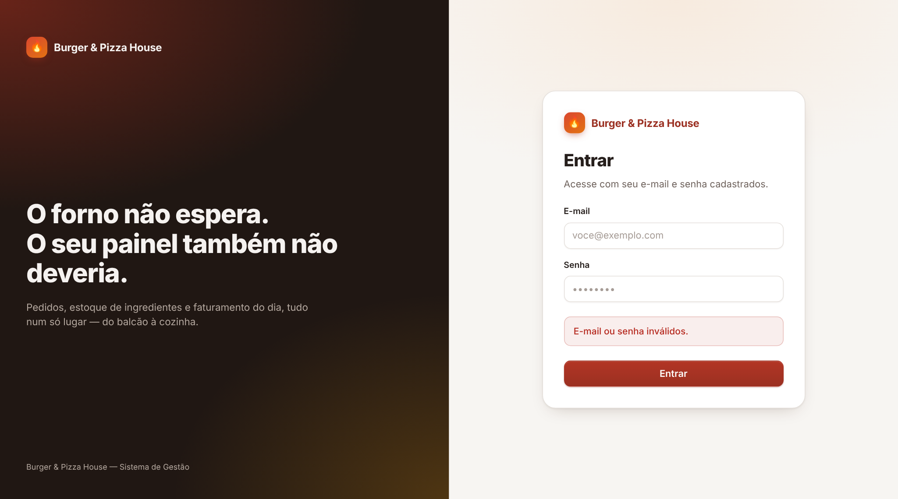
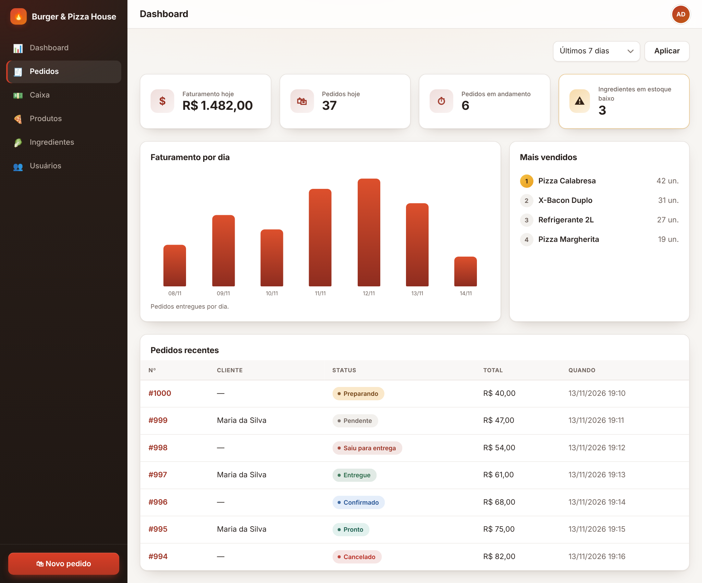
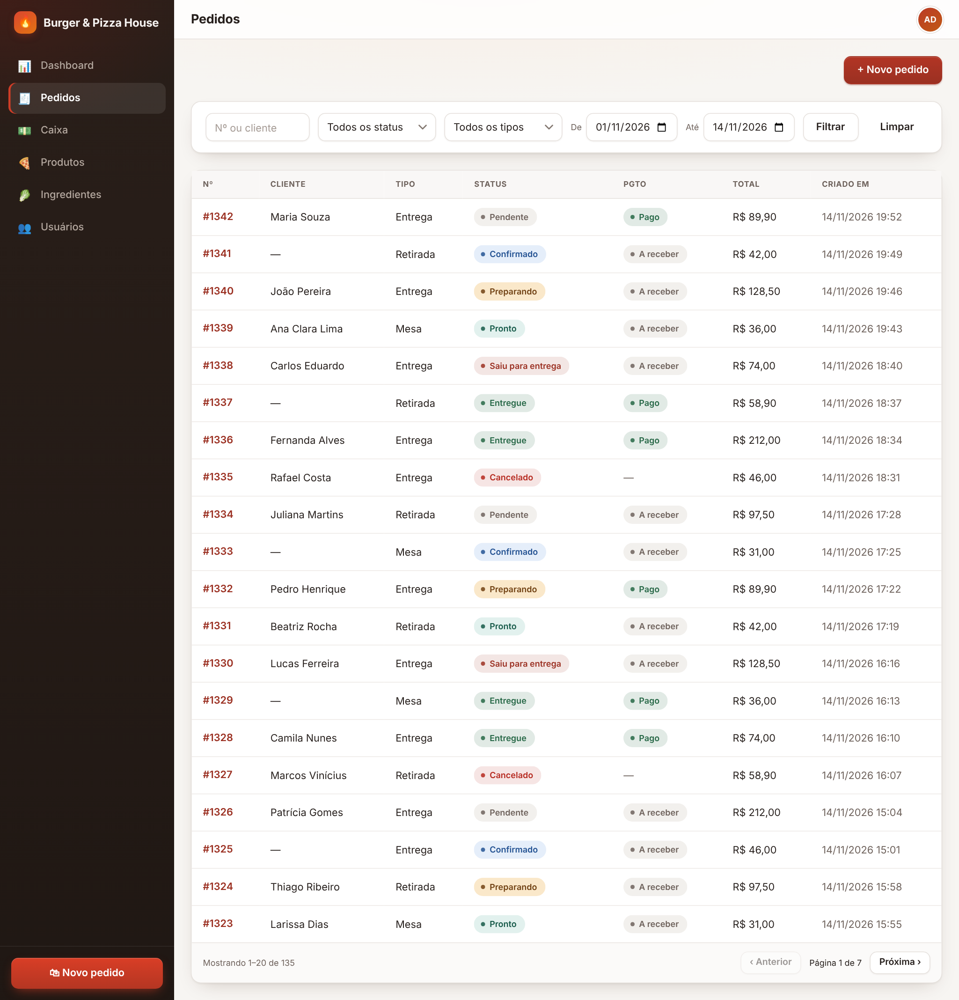
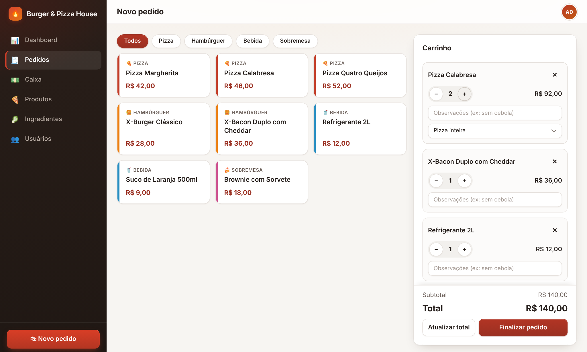
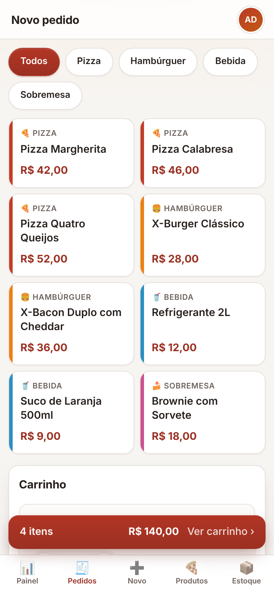
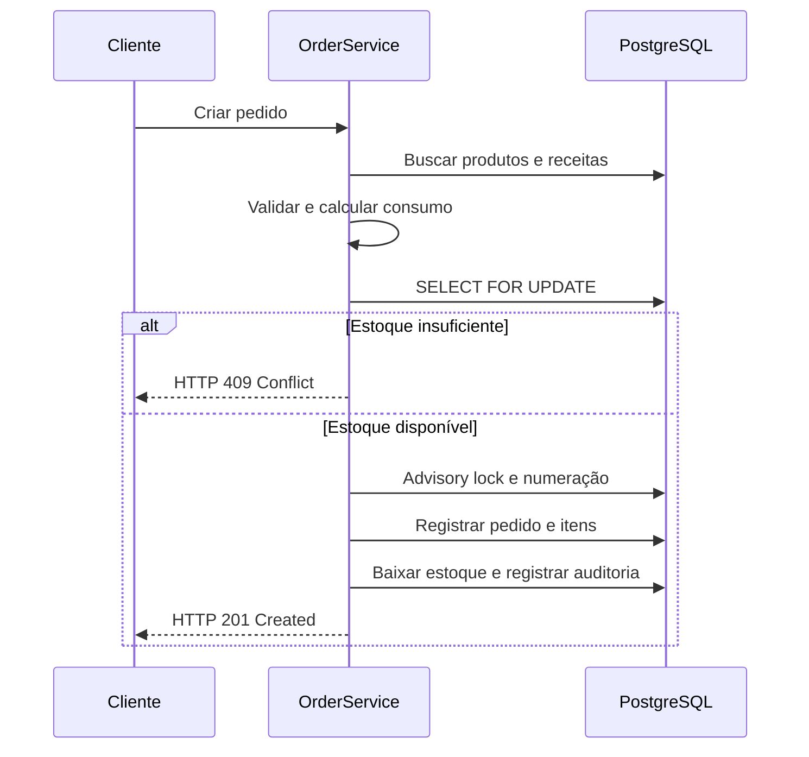

# 🔥 Burger & Pizza House

<p align="center">
  
  
  
  
  
  
</p>

<p align="center">
  <a href="https://hub.xerj.org/contributors/adanwilliamdev">
    
  </a>
</p>

<p align="center">
  <strong>ERP para hamburguerias e pizzarias.</strong>
  <br>
  Gestão de pedidos, produtos, receitas, estoque, pagamentos e vendas em uma única plataforma.
</p>

---

## 📌 Sobre o projeto

O **Burger & Pizza House** é um sistema ERP desenvolvido em Java para gerenciamento operacional de hamburguerias e pizzarias.

A aplicação utiliza uma arquitetura centralizada em Spring Boot, responsável pela interface web, API REST e integração com PostgreSQL e Redis.

O projeto prioriza consistência transacional, controle de concorrência, segurança e integridade dos dados.

## 🛠️ Tecnologias

| Categoria | Tecnologias |
|---|---|
| Backend | Java 21, Spring Boot 4.1 |
| Frontend | Thymeleaf, htmx, JavaScript, CSS |
| Segurança | Spring Security 7, JWT, CSRF |
| Persistência | Spring Data JPA, Hibernate 7 |
| Banco de dados | PostgreSQL 16 |
| Migrações | Flyway |
| Cache | Redis 7 |
| API | Spring MVC, springdoc-openapi |
| Observabilidade | Spring Boot Actuator |
| Testes | JUnit 5, Mockito, MockMvc, JaCoCo |
| Infraestrutura | Docker, Docker Compose |
| CI/CD | GitHub Actions |

## 🚀 Funcionalidades

### 📋 Pedidos
- Cadastro e gerenciamento de pedidos.
- Listagem paginada com pesquisa e filtros.
- Carrinho dinâmico com htmx.
- Observações por item, descontos e taxas de entrega.
- Atendimento por entrega, retirada ou mesa.
- Controle de status e cancelamentos.
- Numeração sequencial e exclusiva.

### 🍕 Produtos e receitas
- Cadastro de produtos e categorias.
- Receitas com ingredientes e quantidades.
- Pizzas com até quatro sabores.
- Cálculo proporcional de consumo de ingredientes.
- Preservação do histórico de produtos vendidos.

### 📦 Estoque
- Cadastro e gerenciamento de ingredientes.
- Estoque mínimo e alertas de reposição.
- Ajustes manuais de entrada e saída.
- Baixa automática conforme as receitas.
- Histórico auditável de movimentações.
- Devolução de ingredientes em cancelamentos.

### 📊 Dashboard
- Faturamento e pedidos do dia.
- Pedidos em andamento.
- Ingredientes com estoque baixo.
- Produtos mais vendidos.
- Histórico de faturamento por período.

### 💳 Pagamentos e caixa
- Registro de pagamentos.
- Cálculo automático de troco.
- Controle de pedidos a receber.
- Fechamento de caixa por data.
- Consolidação por forma de pagamento.

### 🔐 Segurança e permissões

| Perfil | Permissões |
|---|---|
| `ADMIN` | Gerenciamento de produtos, ingredientes, usuários e operações administrativas |
| `MANAGER` | Operação de pedidos e consulta ao dashboard |
| `OPERATOR` | Operação de pedidos e consulta ao dashboard |

---

## 🖥️ Screenshots

### Login e Dashboard

<p align="center">
  
  
</p>

### Pedidos

<p align="center">
  
</p>

### Novo pedido

<p align="center">
  
</p>

<p align="center">
  
  
</p>

## 🏗️ Arquitetura e decisões técnicas

### Consistência e concorrência

- Bloqueio pessimista com `SELECT ... FOR UPDATE` para proteger o estoque em operações simultâneas.
- Bloqueio de ingredientes em ordem determinística para reduzir deadlocks.
- Restrição `CHECK (current_stock >= 0)` no PostgreSQL.
- Numeração de pedidos protegida por advisory lock e índice único.
- Operações de pedido, itens, estoque e auditoria executadas em uma única transação.
- Valores monetários e quantidades utilizando `BigDecimal` e `NUMERIC`.

### Integridade do estoque

- Baixa automática conforme a receita dos produtos.
- Devolução de ingredientes baseada no histórico de movimentações.
- Prevenção de devoluções duplicadas em cancelamentos simultâneos.
- Registro de entradas, saídas, ajustes e perdas.
- Histórico preservado mesmo após alterações nas receitas.

### Autenticação e segurança

- JWT com access token e refresh token.
- Rotação e revogação de refresh tokens.
- Identificador único `jti` e blacklist no Redis.
- Access token com validade padrão de 15 minutos.
- Proteção contra força bruta com bloqueio por e-mail e IP.
- Proteção CSRF na interface web.
- Controle de acesso por perfil.
- Cabeçalhos CSP, HSTS, Referrer-Policy e Permissions-Policy.
- Validação de segredos obrigatórios no ambiente de produção.

### Resiliência

O Redis é utilizado para cache, blacklist de tokens e controle de tentativas de autenticação. Sua indisponibilidade não impede o processamento de vendas, mantendo as operações críticas protegidas.

## 🔄 Fluxo de criação de pedidos



## 🗄️ Modelo de dados


## 🐳 Executando o projeto

### Pré-requisitos

- Java 21
- Docker e Docker Compose
- Maven 3.9+ (execução local)

### Docker Compose

```bash
git clone https://github.com/adanwilliamdev/Burger-Pizza-House.git

cd Burger-Pizza-House

docker compose up --build
```

A aplicação estará disponível em:

| Serviço | URL |
|---|---|
| Aplicação | http://localhost:8080 |
| Swagger UI | http://localhost:8080/docs |
| Health | http://localhost:8080/api/health |
| Readiness | http://localhost:8080/api/health/ready |

**Credenciais iniciais:**

```text
E-mail: admin@burgerpizzahouse.com
Senha: admin123
```

### Execução local

Inicie PostgreSQL e Redis:

```bash
docker compose up -d postgres redis
```

Execute a aplicação:

```bash
mvn spring-boot:run
```

As migrações Flyway e os dados iniciais são executados automaticamente.

## 🚀 Ambiente de produção

Configure os segredos:

```bash
cp .env.prod.example .env.prod
```

Preencha as variáveis:

```env
POSTGRES_PASSWORD=
REDIS_PASSWORD=
JWT_SECRET_KEY=
SEED_ADMIN_PASSWORD=
```

Gere uma chave JWT:

```bash
openssl rand -hex 32
```

Inicie o ambiente:

```bash
docker compose --env-file .env.prod -f docker-compose.prod.yml up -d --build
```

O ambiente de produção utiliza:
- PostgreSQL e Redis em rede interna.
- Redis autenticado e com persistência.
- Segredos externos ao código-fonte.
- Swagger desabilitado por padrão.
- HTTPS através de proxy reverso.
- Validação de credenciais administrativas e chaves JWT.

## 🧪 Testes

```bash
# Testes unitários
mvn test

# Testes de integração e cobertura
mvn verify
```

Para os testes de integração, inicie PostgreSQL e Redis:

```bash
docker compose up -d postgres redis
```

### Cenários cobertos

- Concorrência na criação de pedidos.
- Integridade e baixa de estoque.
- Cancelamentos e devoluções simultâneas.
- Unicidade da numeração de pedidos.
- Autenticação e rotação de tokens.
- Revogação de sessões.
- Autorização por perfil.
- Proteção CSRF.
- Validação de regras de negócio.

Relatório JaCoCo:

```text
target/site/jacoco/index.html
```

## 🔌 API REST

Prefixo: `/api`

Autenticação:

```http
Authorization: Bearer <access_token>
```

| Recurso | Endpoints |
|---|---|
| Autenticação | `POST /api/auth/login`, `/refresh`, `/logout` |
| Usuário autenticado | `GET /api/auth/me` |
| Pedidos | `GET/POST /api/orders` |
| Detalhes do pedido | `GET /api/orders/{id}` |
| Status | `POST /api/orders/{id}/status` |
| Pagamento | `POST /api/orders/{id}/payment` |
| Produtos | `GET /api/products` |
| Ingredientes | `GET /api/ingredients` |
| Estoque | `POST /api/ingredients/{id}/stock` |
| Usuários | `GET/POST /api/users` |
| Dashboard | `GET /api/dashboard?days=7` |
| Fechamento de caixa | `GET /api/orders/cash-closing?date=AAAA-MM-DD` |

Documentação interativa:

- `/docs`
- `/v3/api-docs`

## 📁 Estrutura do projeto

```text
src/main/
├── java/com/burgerpizzahouse/
│   ├── config/
│   ├── domain/
│   ├── repository/
│   ├── service/
│   ├── security/
│   ├── api/
│   ├── dto/
│   └── web/
│
└── resources/
    ├── db/migration/
    ├── templates/
    └── static/
        ├── css/
        ├── js/
        └── favicon/

docs/
└── screenshots/
```

## 📄 Licença

Este projeto está sob a licença [MIT](LICENSE).

---

<p align="center">
  Desenvolvido com ☕ Java 21 e Spring Boot.
  <br>
  <strong>Burger & Pizza House</strong>
</p>
