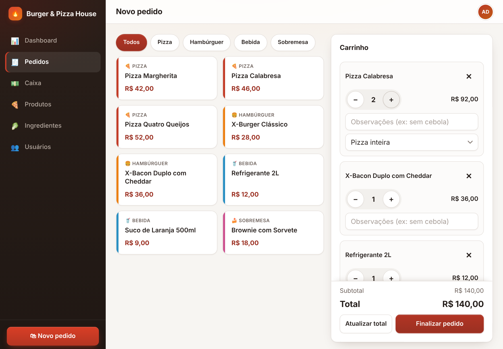
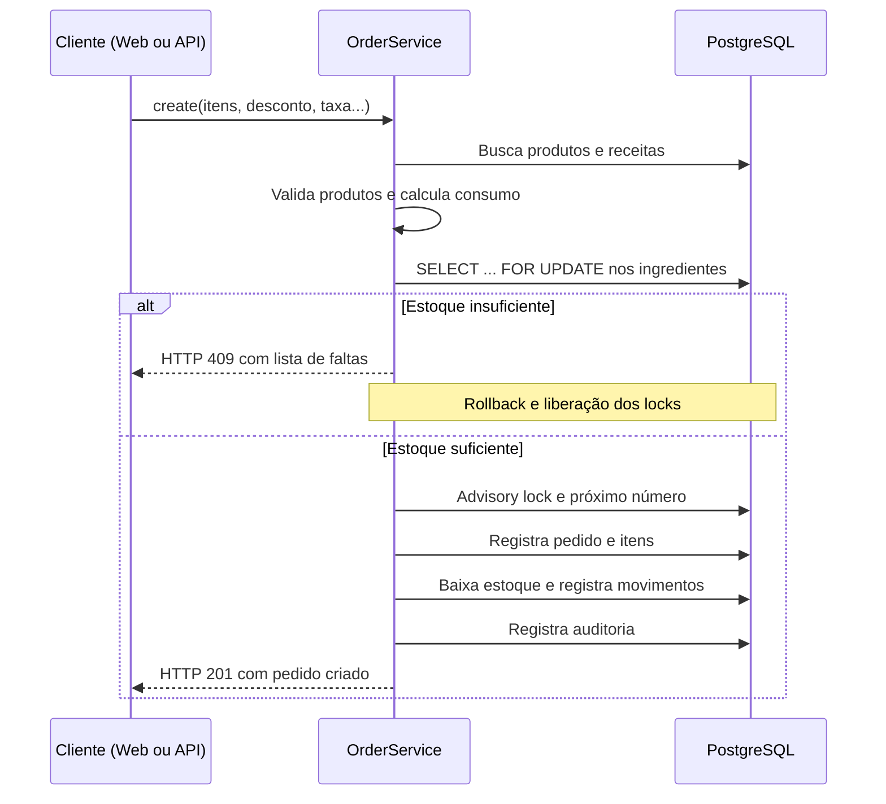
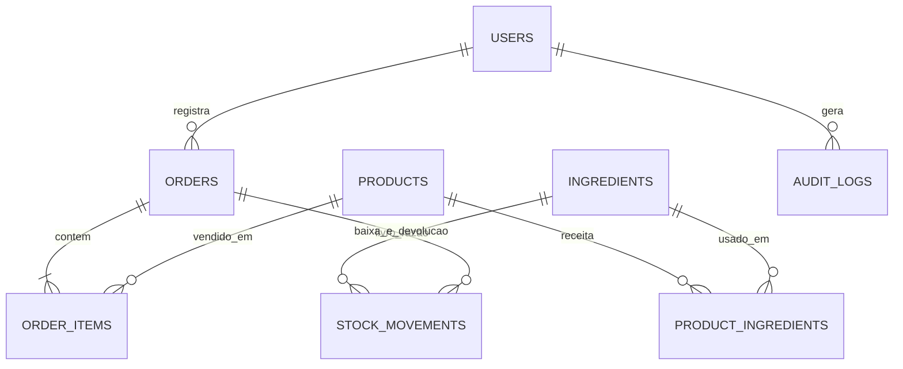

# 🔥 Burger & Pizza House

<p align="center">
  
  
  
  
  
  
</p>

<p align="center">
  <a href="https://hub.xerj.org/contributors/adanwilliamdev">
    
  </a>
</p>

<p align="center">
  <strong>Gestão inteligente para hamburguerias e pizzarias.</strong>
  <br>
  Pedidos, catálogo de produtos, receitas, controle de estoque e gestão financeira em uma única plataforma.
</p>

---

## 📌 Sobre o projeto

O **Burger & Pizza House** é um sistema ERP desenvolvido para hamburguerias e pizzarias, com foco na gestão operacional, controle de estoque e processamento seguro de pedidos.

A aplicação utiliza uma arquitetura **100% Java**, com uma única aplicação Spring Boot responsável por servir a interface web, disponibilizar a API REST e integrar os serviços de persistência e cache.

O projeto foi desenvolvido com atenção especial à consistência dos dados, concorrência entre operações, segurança e integridade do estoque.

### Principais recursos

- 📦 Gestão de pedidos e fluxo operacional.
- 🍕 Catálogo de produtos com receitas e ingredientes.
- 🥩 Controle de estoque e movimentações auditáveis.
- 📊 Dashboard com indicadores de vendas.
- 🔐 Autenticação JWT e controle de acesso por perfil.
- 💳 Controle de pagamentos, troco e fechamento de caixa.
- ⚡ Redis para cache, segurança e controle de tentativas.
- 🐳 Ambiente de desenvolvimento e produção com Docker.

---

## 🛠️ Stack tecnológica

| Camada | Tecnologias |
|---|---|
| Linguagem e build | Java 21, Maven |
| Backend | Spring Boot 4.1, Spring Framework 7, Spring MVC |
| Frontend | Thymeleaf, htmx, JavaScript, CSS |
| Segurança | Spring Security 7, JWT, CSRF |
| Persistência | Spring Data JPA, Hibernate 7 |
| Banco de dados | PostgreSQL 16 |
| Migrações | Flyway |
| Cache | Redis 7 |
| Documentação | springdoc-openapi, Swagger UI |
| Observabilidade | Spring Boot Actuator |
| Testes | JUnit 5, Mockito, MockMvc, JaCoCo |
| Infraestrutura | Docker, Docker Compose |
| CI/CD | GitHub Actions |

---

## 🚀 Funcionalidades

### 📋 Gestão de pedidos

- Listagem paginada no servidor, com 20 registros por página e total de resultados.
- Pesquisa por número do pedido ou nome do cliente.
- Filtros por status, tipo de atendimento e período.
- Carrinho com observações individuais por item.
- Aplicação de descontos e taxas de entrega.
- Tipos de atendimento: entrega, retirada e mesa.
- Formas de pagamento configuráveis.
- Numeração sequencial e exclusiva dos pedidos.
- Fluxo de status:

  `Pendente → Confirmado → Preparando → Pronto → Saiu para entrega → Entregue`

- Cancelamento permitido em qualquer estado não final.

### 🍔 Catálogo de produtos

- Cadastro de produtos organizados por categoria.
- Associação de ingredientes e quantidades por receita.
- Suporte a pizzas com até quatro sabores.
- Desativação de produtos com histórico de pedidos, preservando os registros anteriores.

### 📦 Controle de estoque

- Cadastro e gerenciamento de ingredientes.
- Definição de estoque mínimo.
- Alertas de estoque baixo.
- Ajustes manuais de entrada e saída.
- Livro-razão de movimentações.
- Histórico de consumo por pedidos e devoluções.
- Proteção contra inconsistências em operações simultâneas.

### 📊 Dashboard

- Faturamento diário.
- Quantidade de pedidos do dia.
- Pedidos em andamento.
- Ingredientes com estoque baixo.
- Produtos mais vendidos.
- Histórico de faturamento por período: 7, 14, 30 e 90 dias.
- Consideração do fuso horário configurado para o negócio.

### 👥 Controle de acesso

| Perfil | Permissões |
|---|---|
| `ADMIN` | Gerenciamento de produtos, ingredientes, usuários e operações administrativas |
| `MANAGER` | Operação de pedidos e consulta ao dashboard |
| `OPERATOR` | Operação de pedidos e consulta ao dashboard |

### 💳 Pagamentos e caixa

- Registro de pagamentos.
- Cálculo automático de troco para pagamentos em dinheiro.
- Identificação de pedidos pendentes de pagamento.
- Fechamento de caixa por data.
- Totalização por forma de pagamento.
- Separação entre valores recebidos, valores a receber e pedidos cancelados.

---

## 🖥️ Demonstração das telas

### Autenticação e dashboard

<p align="center">
  
  
</p>

### Gestão de pedidos

Listagem paginada com pesquisa por número ou cliente e filtros por status, tipo e período.

<p align="center">
  
</p>

### Novo pedido

Carrinho dinâmico com atualização parcial da interface utilizando htmx, sem necessidade de recarregar toda a página.

<p align="center">
  
</p>

<p align="center">
  
  
</p>

> As imagens estão armazenadas em `docs/screenshots/`. Para capturar novas imagens com a aplicação em execução, utilize `python docs/screenshots/capture.py`.

---

## ⚙️ Detalhes técnicos

### Paginação, filtros e carrinho

**Interface web:**

- `GET /orders` utiliza paginação no servidor com `Page` e total de resultados.
- Filtros disponíveis: `q`, `status`, `type`, `start_date`, `end_date` e `page`.
- O parâmetro `q` aceita número do pedido, com ou sem `#`, ou parte do nome do cliente.
- A listagem utiliza `OrderSummaryResponse`, evitando carregar os itens completos de cada pedido.

**API REST:**

- `GET /api/orders` também aceita o parâmetro `q`.
- O total de resultados é informado pelo cabeçalho `X-Total-Count`.
- O corpo continua retornando um array, preservando a compatibilidade com clientes existentes.

**Carrinho dinâmico:**

- Operações de adicionar, remover, incrementar, decrementar e selecionar categorias utilizam htmx.
- Atualização parcial dos elementos `#catalog`, `#cart-lines`, `#cart-summary` e `#cart-bar`.
- Renderização executada no servidor através de `templates/orders/new-fragments.html`.
- Funcionamento alternativo com POST e redirect, mesmo sem JavaScript.

**Responsividade:**

| Dispositivo | Comportamento |
|---|---|
| Desktop | Catálogo e carrinho em layout amplo |
| Tablet (700–1023 px) | Produtos e carrinho lado a lado, com total e finalização sempre visíveis |
| Celular (< 700 px) | Layout empilhado e barra para visualizar o carrinho |

As interfaces de toque utilizam alvos de interação com pelo menos 44 px.

---

## 🔒 Garantias de robustez e consistência

O sistema foi projetado para proteger as operações críticas de uma aplicação comercial, especialmente pedidos simultâneos, movimentações de estoque e autenticação.

### Controle de concorrência

- **Bloqueio pessimista:** ingredientes são bloqueados com `SELECT ... FOR UPDATE` antes da validação do saldo.
- **Ordem determinística:** os bloqueios são adquiridos sempre pela ordem de ID, reduzindo o risco de deadlocks.
- **Restrição no banco:** `CHECK (current_stock >= 0)` impede saldos negativos.
- **Numeração exclusiva:** advisory lock transacional combinado com índice único evita números de pedidos duplicados.

### Transações e integridade

- Pedido, itens, baixa de estoque, movimentações e auditoria são registrados em uma única transação.
- Falta de estoque retorna HTTP `409` com a relação exata de ingredientes insuficientes.
- Cancelamentos devolvem os ingredientes no máximo uma vez.
- A devolução utiliza o histórico de movimentações, mesmo quando a receita do produto é alterada posteriormente.
- Valores monetários e quantidades utilizam `NUMERIC` e `BigDecimal`, evitando erros de ponto flutuante.

### Auditoria do estoque

- Alterações de ingredientes bloqueiam a linha correspondente durante a operação.
- Ajustes de saldo são registrados no livro-razão.
- Pedidos, cancelamentos, ajustes e alterações pela API geram registros de movimentação.
- Ingredientes com histórico de movimentações não podem ser excluídos (`ON DELETE RESTRICT`).
- A edição de dados cadastrais não sobrescreve indevidamente o saldo de estoque.

### Resiliência do Redis

O Redis atua como componente auxiliar. Se ficar indisponível, o sistema continua processando vendas.

A exceção é a blacklist de tokens: nesse cenário, a autenticação falha de forma segura (*fail closed*), recusando a operação em vez de aceitar um token possivelmente revogado.

### Segurança da aplicação

- JWT com identificador único (`jti`).
- Rotação de refresh tokens.
- Access tokens com validade curta, de 15 minutos por padrão.
- Revogação de tokens através de blacklist no Redis.
- Proteção contra força bruta com bloqueio temporário por e-mail e IP.
- Contadores independentes por IP, e-mail e combinação dos dois.
- Proteção contra CSRF na interface web.
- Perfis de autorização para páginas, API e Actuator.
- Em produção, a aplicação recusa iniciar com a chave JWT padrão ou curta e com a senha administrativa padrão `admin123`.

---

## 🔄 Fluxo de criação de pedidos

O processamento de pedidos utiliza transações e bloqueios no banco para garantir que duas operações simultâneas não consumam o mesmo estoque disponível.



---

## 🗄️ Modelo de dados



---

## 🐳 Como executar

### Pré-requisitos

- JDK 21.
- Docker e Docker Compose.
- Maven 3.9+ (para execução local sem container da aplicação).
- PostgreSQL 16 e Redis 7 (para execução local).

### 1. Docker Compose (recomendado)

Clone o repositório:

```bash
git clone https://github.com/adanwilliamdev/Burger-Pizza-House.git

cd Burger-Pizza-House
```

Inicie a aplicação e suas dependências:

```bash
docker compose up --build
```

O ambiente de desenvolvimento publica as portas do PostgreSQL e Redis somente em `127.0.0.1`, utilizando as credenciais padrão do repositório.

### 2. Acessar a aplicação

| Serviço | Endereço |
|---|---|
| Aplicação web | http://localhost:8080 |
| Swagger UI | http://localhost:8080/docs |
| Health check | http://localhost:8080/api/health |
| Readiness | http://localhost:8080/api/health/ready |

O Actuator disponibiliza:

- `/actuator/health`
- `/actuator/metrics`

Esses endpoints exigem autenticação como `ADMIN`.

**Credenciais iniciais de desenvolvimento:**

```text
E-mail: admin@burgerpizzahouse.com
Senha:  admin123
```

> Em produção, essa senha padrão não é permitida. Configure `SEED_ADMIN_PASSWORD` antes da primeira inicialização.

### 3. Execução local

Caso prefira executar a aplicação fora do Docker:

Inicie somente as dependências:

```bash
docker compose up -d postgres redis
```

Execute a aplicação:

```bash
mvn spring-boot:run
```

As migrações do Flyway e os dados iniciais são executados automaticamente.

O seed é idempotente e não sobrescreve dados existentes. Para desativá-lo:

```properties
APP_SEED_ENABLED=false
```

---

## 🚀 Configuração para produção

O projeto possui um arquivo Compose específico para produção.

### 1. Preparar os segredos

```bash
cp .env.prod.example .env.prod
```

Preencha as variáveis:

```env
POSTGRES_PASSWORD=
REDIS_PASSWORD=
JWT_SECRET_KEY=
SEED_ADMIN_PASSWORD=
```

Para gerar uma chave segura:

```bash
openssl rand -hex 32
```

### 2. Subir o ambiente

```bash
docker compose --env-file .env.prod -f docker-compose.prod.yml up -d --build
```

### 3. Medidas de segurança em produção

- PostgreSQL e Redis ficam em rede interna Docker (`internal: true`), sem portas publicadas.
- Redis utiliza autenticação por senha e persistência em disco.
- Segredos ficam exclusivamente no `.env.prod`, ignorado pelo Git e pelo Docker build.
- A inicialização falha caso algum segredo obrigatório esteja ausente.
- O Swagger fica desabilitado por padrão.
- A aplicação utiliza `APP_ENV=production`.
- A aplicação escuta em `127.0.0.1:8080`, exigindo proxy reverso com HTTPS para exposição externa.

> Importante: `POSTGRES_PASSWORD` é aplicada na criação inicial do volume. Para alterá-la posteriormente, utilize `ALTER USER` no PostgreSQL.

### Variáveis principais

| Variável | Finalidade |
|---|---|
| `DATABASE_URL` | Endereço do banco |
| `DATABASE_USER` | Usuário do banco |
| `DATABASE_PASSWORD` | Senha do banco |
| `REDIS_URL` | Conexão com Redis |
| `JWT_SECRET_KEY` | Chave de assinatura JWT |
| `APP_ENV` | Ambiente da aplicação |
| `BUSINESS_TIMEZONE` | Fuso horário do negócio |
| `CORS_ORIGINS` | Origens permitidas |
| `DOCS_ENABLED` | Habilita documentação Swagger |
| `LOGIN_MAX_ATTEMPTS` | Limite de tentativas de login |
| `LOGIN_LOCK_SECONDS` | Tempo de bloqueio |
| `APP_SEED_ENABLED` | Ativa ou desativa seed |
| `SEED_ADMIN_PASSWORD` | Senha do administrador inicial |

Consulte `.env.example` e `.env.prod.example` para a configuração completa.

---

## 🧪 Testes

O projeto possui testes unitários e de integração, com foco nas regras de negócio, segurança e concorrência.

### Executar testes

```bash
# Testes unitários
mvn test

# Testes de integração e relatório de cobertura
mvn verify
```

Para executar `mvn verify`, é necessário ter PostgreSQL e Redis em execução:

```bash
docker compose up -d postgres redis
```

### Cobertura dos testes

| Área | Cenários testados |
|---|---|
| Pedidos | Validação, valores, descontos e transições de status |
| Estoque | Baixas, devoluções, ajustes e integridade do histórico |
| Concorrência | Pedidos simultâneos sem venda acima do estoque |
| Numeração | Unicidade dos números de pedidos |
| Cancelamento | Devolução de estoque exatamente uma vez |
| Autenticação | Login, refresh, logout e revogação |
| Segurança | JWT inválido, ausência de token e permissões |
| CSRF | Proteção dos formulários web |
| Autorização | Bloqueio de acessos indevidos por perfil |

O relatório de cobertura JaCoCo é gerado em:

```text
target/site/jacoco/index.html
```

---

## 🔌 API REST

A API utiliza o prefixo `/api` e autenticação por Bearer Token.

```http
Authorization: Bearer <access_token>
```

### Principais endpoints

| Recurso | Endpoints |
|---|---|
| Autenticação | `POST /api/auth/login`, `/refresh`, `/logout` |
| Perfil autenticado | `GET /api/auth/me` |
| Pedidos | `GET/POST /api/orders` |
| Pedido específico | `GET /api/orders/{id}` |
| Status do pedido | `POST /api/orders/{id}/status` |
| Pagamento | `POST /api/orders/{id}/payment` |
| Produtos | `GET /api/products`, `GET /api/products/{id}` |
| Gerenciar produtos | `POST`, `PUT`, `DELETE /api/products` |
| Ingredientes | `GET /api/ingredients` |
| Estoque baixo | `GET /api/ingredients?low_stock=true` |
| Ajustar estoque | `POST /api/ingredients/{id}/stock` |
| Usuários | `GET/POST /api/users` |
| Dashboard | `GET /api/dashboard?days=7` |
| Fechamento de caixa | `GET /api/orders/cash-closing?date=AAAA-MM-DD` |

Operações administrativas exigem o perfil `ADMIN`.

### Documentação interativa

```text
http://localhost:8080/docs
http://localhost:8080/v3/api-docs
```

A documentação é acessível somente para administradores autenticados na interface web e fica desabilitada por padrão em produção.

### Formato de erros

Os erros utilizam o formato:

```json
{
  "detail": "Mensagem de erro"
}
```

Em caso de estoque insuficiente:

```json
{
  "detail": {
    "message": "Estoque insuficiente",
    "shortages": []
  }
}
```

A resposta utiliza HTTP `409 Conflict`.

**Atualização de ingredientes:**

O endpoint `PUT /api/ingredients/{id}` aceita `current_stock` para ajustar o saldo e registrar a diferença no livro-razão. Sem esse campo, o saldo existente é preservado.

---

## 🍕 Regras de negócio

### Pizzas meio a meio e quartos

- Exclusivo para pizzas.
- Suporte a até quatro sabores.
- O campo `half_flavors` recebe os nomes dos outros sabores além do produto principal.
- O preço considera o sabor mais caro.
- O consumo de estoque é proporcional à quantidade de cada sabor.
- Cada receita consome `quantidade ÷ número de sabores`.
- A interface permite selecionar os sabores adicionais diretamente no carrinho.

### Cancelamento de pedidos

O endpoint `POST /api/orders/{id}/status` aceita:

- `cancel_reason`
- `return_to_stock`

Regras:

- Antes do preparo, o padrão é devolver os ingredientes ao estoque.
- A partir do status `Preparando`, o motivo do cancelamento é obrigatório.
- Após o início do preparo, os ingredientes não retornam ao estoque por padrão, sendo registrados como perda.
- A tela de detalhes permite escolher o destino dos insumos.

### Pagamento

Endpoint:

```http
POST /api/orders/{id}/payment
```

Corpo opcional:

```json
{
  "amount_received": 50
}
```

O sistema:

- Marca o pedido como pago.
- Calcula o troco automaticamente para pagamentos em dinheiro.
- Identifica pedidos ainda não pagos como `A receber`.

### Fechamento de caixa

Endpoint:

```http
GET /api/orders/cash-closing?date=AAAA-MM-DD
```

A tela Caixa, disponível para `ADMIN` e `MANAGER`, apresenta:

- Total recebido por forma de pagamento.
- Valores pendentes de recebimento.
- Pedidos cancelados no dia.

---

## 🌐 Proxy reverso e cabeçalhos

A aplicação oferece suporte a Nginx, Traefik e load balancers.

O bloqueio de login depende da identificação correta do IP do cliente. Sem essa configuração, usuários podem compartilhar o mesmo contador de tentativas associado ao IP do proxy.

A aplicação utiliza:

```yaml
server:
  forward-headers-strategy: native
```

Configurável através de `FORWARD_HEADERS_STRATEGY`.

### Nginx

O proxy deve enviar ou sobrescrever os cabeçalhos:

```nginx
proxy_set_header X-Forwarded-For $proxy_add_x_forwarded_for;
proxy_set_header X-Forwarded-Proto $scheme;
```

### Proxies confiáveis

Por padrão, são considerados confiáveis os seguintes intervalos:

- `10.x.x.x`
- `172.16.x.x` até `172.31.x.x`
- `192.168.x.x`
- `127.x.x.x`
- `::1`

Para proxies com IP público, configure `SERVER_TOMCAT_REMOTEIP_INTERNAL_PROXIES` com uma expressão regular que corresponda aos IPs confiáveis.

Sem proxy reverso, utilize:

```env
FORWARD_HEADERS_STRATEGY=none
```

> O modo `framework` não é adequado neste cenário, pois o `ForwardedHeaderFilter` do Spring não altera o resultado de `getRemoteAddr()`.

Para validar a configuração, faça um login com senha incorreta e confira a chave `login:fail:ip:<ip>` no Redis. Ela deve conter o IP real do cliente, não o endereço do proxy.

---

## 🛡️ Cabeçalhos de segurança

A aplicação utiliza políticas de segurança HTTP para reduzir a superfície de ataque.

| Política | Configuração |
|---|---|
| Content-Security-Policy (Web) | `script-src 'self'; style-src 'self'` |
| Content-Security-Policy (API) | `default-src 'none'` |
| Referrer-Policy (Web) | `same-origin` |
| Referrer-Policy (API) | `no-referrer` |
| Permissions-Policy | Câmera, microfone, geolocalização e pagamento desativados |
| HSTS | 1 ano com subdomínios |

O HSTS é enviado somente em requisições HTTPS.

Por causa da CSP, os templates não devem conter:

- Atributos `style="..."`.
- Elementos `<script>` inline.
- Eventos inline como `onclick` e `onsubmit`.

Os estilos ficam em `static/css/app.css`, com classes utilitárias como `w-200` e `gap-16`.

Os comportamentos ficam em `static/js/app.js`. Atributos como `data-confirm` e `data-height` permitem configurar comportamentos sem JavaScript inline.

O teste `TemplatesCspTest` verifica se essas restrições continuam sendo respeitadas.

---

## 📁 Estrutura do projeto

```text
src/
└── main/
    ├── java/
    │   └── com/burgerpizzahouse/
    │       ├── config/        # Configurações, segurança, seed e OpenAPI
    │       ├── domain/        # Entidades JPA e enums
    │       ├── repository/    # Repositórios e consultas com locks
    │       ├── service/       # Regras de negócio
    │       ├── security/      # JWT, filtros e handlers
    │       ├── api/           # Controllers REST
    │       ├── dto/           # Contratos da API
    │       └── web/           # Controllers e formulários Thymeleaf
    │
    └── resources/
        ├── db/migration/      # Migrações Flyway
        ├── templates/         # Páginas Thymeleaf
        └── static/
            ├── css/           # Estilos
            ├── js/            # JavaScript
            └── favicon/       # Ícones

docs/
└── screenshots/               # Capturas das telas
```

---

## 📌 Observações importantes

- **Receitas:** utilize o botão "Adicionar ingrediente" no formulário de produtos para incluir quantas linhas de receita forem necessárias.
- **Edição de estoque:** a edição cadastral de ingredientes não altera o saldo. Utilize a opção "Ajustar estoque" para registrar movimentações.
- **Histórico:** ingredientes com movimentações não podem ser excluídos.
- **Swagger:** desligado por padrão em produção, podendo ser habilitado com `DOCS_ENABLED=true`.
- **Redis:** sua indisponibilidade não impede a criação de pedidos, mas operações que dependem da blacklist de tokens são recusadas com segurança.

---

## 📦 Versões e compatibilidade

| Componente | Versão |
|---|---|
| Java | 21 |
| Spring Boot | 4.1.2 |
| Spring Framework | 7 |
| Spring Security | 7 |
| Hibernate | 7 |
| Jackson | 3 |
| springdoc-openapi | 3.1.0 |
| JJWT | 0.13.0 |
| PostgreSQL | 16 |
| Redis | 7 |

### Migração para Spring Boot 4

O projeto utiliza a linha Spring Boot 4, com Spring Framework 7, Spring Security 7, Hibernate 7 e Jackson 3.

Algumas mudanças importantes em relação às versões anteriores:

- `spring-boot-starter-webmvc` substitui o antigo `spring-boot-starter-web`.
- `spring-boot-starter-flyway` passa a ser utilizado para autoconfiguração do Flyway.
- Testes utilizam `spring-boot-starter-webmvc-test` e `spring-boot-starter-security-test`.
- Jackson 3 utiliza o pacote `tools.jackson`.
- As anotações `@JsonProperty` continuam em `com.fasterxml.jackson.annotation`.
- `JacksonException` utiliza exceções não verificadas.
- `@AutoConfigureMockMvc` passa a ser importado de `org.springframework.boot.webmvc.test.autoconfigure.AutoConfigureMockMvc`.

---

## 📄 Licença

Este projeto está licenciado sob a licença **MIT**.

Consulte o arquivo `LICENSE` para mais informações.

---

<p align="center">
  Desenvolvido com ☕ Java 21 e Spring Boot.
  <br>
  <strong>Burger & Pizza House</strong>
  <br>
  <sub>Consistência, segurança e tecnologia aplicadas à gestão de negócios.</sub>
</p>
