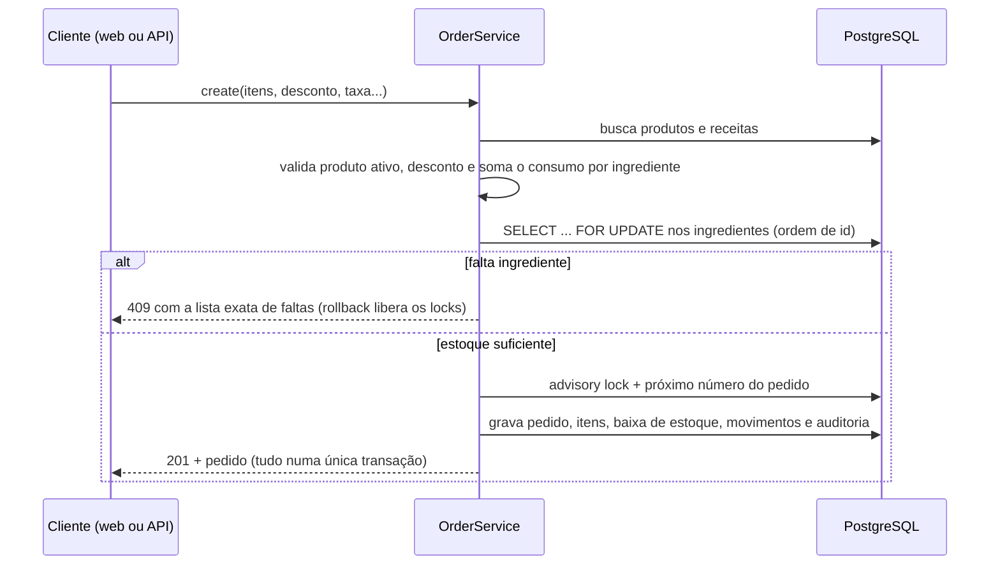
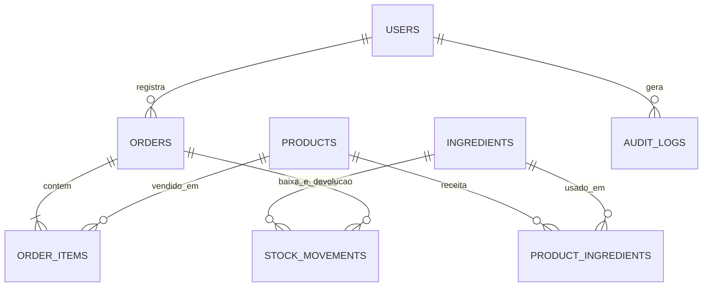

# 🔥 Burger & Pizza House

[](https://github.com/adanwilliamdev/Burger-Pizza-House/actions/workflows/ci.yml)


[](https://hub.xerj.org/contributors/adanwilliamdev)

ERP para hamburgueria e pizzaria: **pedidos**, **catálogo de produtos com receita**, **estoque de ingredientes** e **dashboard** de vendas. Aplicação 100% Java: uma única aplicação Spring Boot que serve a interface web, a API REST e fala com PostgreSQL e Redis.

## Stack

| Camada | Tecnologia |
|---|---|
| Linguagem / build | Java 21, Maven |
| Aplicação | Spring Boot 3.3 (Spring MVC) |
| Interface web | Thymeleaf (renderização no servidor, sem JavaScript obrigatório) + CSS próprio |
| Segurança | Spring Security — sessão + CSRF na interface; JWT (access/refresh) na API |
| Persistência | Spring Data JPA / Hibernate, PostgreSQL 16, migrações com Flyway |
| Cache e controle | Redis 7 (cache do dashboard, blacklist de tokens, anti força bruta) |
| Documentação da API | springdoc-openapi (Swagger UI) |
| Observabilidade | Spring Boot Actuator (`health`, `info`, `metrics`, somente ADMIN) |
| Testes | JUnit 5, Mockito, MockMvc + Spring Security Test (unitários + integração com concorrência real), cobertura com JaCoCo |
| Infra | Docker, Docker Compose, GitHub Actions |

## Funcionalidades

- **Pedidos**: carrinho com observações por item, desconto, taxa de entrega, tipo (entrega/retirada/mesa) e forma de pagamento; numeração sequencial; fluxo de status (`Pendente → Confirmado → Preparando → Pronto → Saiu para entrega → Entregue`, com cancelamento a partir de qualquer estado não final).
- **Catálogo**: produtos por categoria com **receita** (ingredientes e quantidades). Produto que já tem pedidos é desativado em vez de apagado, preservando o histórico.
- **Estoque**: ingredientes com estoque mínimo, alerta de estoque baixo, ajuste manual (entrada/saída) e livro-razão de movimentações.
- **Dashboard**: faturamento e pedidos do dia, pedidos em andamento, estoque baixo, mais vendidos e faturamento por dia (7/14/30/90 dias), no fuso do negócio.
- **Perfis**: `ADMIN` gerencia produtos, ingredientes e usuários; `MANAGER` e `OPERATOR` operam pedidos e consultam o painel.

## Garantias de robustez

- **Nunca vende estoque que não existe**, nem com pedidos simultâneos: as linhas de ingredientes são travadas (`SELECT … FOR UPDATE`, sempre em ordem de id, sem deadlock) *antes* de validar o saldo. Há ainda um `CHECK (current_stock >= 0)` no banco como rede de segurança.
- **Pedido atômico**: pedido, itens, baixa de estoque, movimentos e auditoria numa única transação. Falta de estoque devolve a lista exata de ingredientes em falta.
- **Cancelamento devolve o estoque exatamente uma vez**, com base no livro-razão (`stock_movements`), mesmo que a receita mude depois.
- **Número do pedido sem repetição** (advisory lock da transação + índice único).
- **Dinheiro e quantidades em `NUMERIC`/`BigDecimal`** — sem erro de ponto flutuante.
- **Redis é auxiliar**: se cair, o sistema continua vendendo (só a blacklist de tokens falha "fechada": recusa a operação em vez de aceitar token possivelmente revogado).
- **Segurança**: JWT com `jti` único e rotação de refresh token; access token de curta duração (15 min por padrão); bloqueio temporário de login por **e-mail + IP**, por IP e por e-mail (quem erra a senha de outra pessoa a partir de outro IP não consegue bloquear a conta dela); em `APP_ENV=production` a aplicação se recusa a subir com a chave JWT padrão/curta **e com a senha de admin padrão** (`admin123`).
- **Estoque auditável**: editar um ingrediente trava a linha e nunca sobrescreve a baixa de um pedido em andamento; qualquer mudança de saldo (pedido, cancelamento, ajuste ou edição pela API) vira uma linha no livro-razão. Ingrediente com histórico de movimentações não pode ser excluído (o banco usa `ON DELETE RESTRICT`).

## Como funciona a criação de um pedido



## Modelo de dados



## Como rodar

### Docker (recomendado)

```bash
docker compose up --build
```

- Aplicação: http://localhost:8080
- API (Swagger): http://localhost:8080/docs (desligue em produção com `DOCS_ENABLED=false`)
- Saúde: http://localhost:8080/api/health e `/api/health/ready`
- Actuator (somente ADMIN logado): `/actuator/health`, `/actuator/metrics`

Login inicial: `admin@burgerpizzahouse.com` / `admin123`. Com `APP_ENV=production` a aplicação **não sobe** com essa senha: defina `SEED_ADMIN_PASSWORD` (8+ caracteres) antes do primeiro start.

Opcional: `cp .env.example .env` para ajustar variáveis (o Compose lê o arquivo automaticamente).

### Local (sem Docker para a aplicação)

Requisitos: JDK 21, Maven 3.9+, PostgreSQL e Redis em execução.

```bash
docker compose up -d postgres redis   # só as dependências
mvn spring-boot:run
```

As migrações (Flyway) e os dados iniciais rodam automaticamente na inicialização. O seed é idempotente e nunca sobrescreve dados existentes; desligue com `APP_SEED_ENABLED=false`.

## Testes

```bash
mvn test      # unitários (estoque, dinheiro, status, validações de pedido, anti força bruta)
mvn verify    # + integração (segurança, auth, estoque, concorrência real) e relatório de cobertura
```

`mvn verify` exige PostgreSQL e Redis no ar (`docker compose up -d postgres redis`) e gera o relatório de cobertura em `target/site/jacoco/index.html`.

Os testes de integração cobrem:

- **Concorrência**: pedidos simultâneos que nunca vendem além do estoque, números de pedido únicos e cancelamento simultâneo devolvendo o estoque uma única vez.
- **Segurança**: 401 sem token ou com token inválido, 403 para OPERATOR/MANAGER em rotas de ADMIN (API, páginas web e Actuator), redirecionamento ao login e CSRF no formulário.
- **Autenticação**: login, `/me`, rotação do refresh token (o antigo deixa de valer), logout revogando o refresh, tokens de tipos trocados recusados e bloqueio por tentativas.
- **Estoque**: editar ingrediente mantém saldo e livro-razão consistentes e preserva o histórico na exclusão.

## API REST

Prefixo `/api`, autenticada por `Authorization: Bearer <access_token>`. Documentação interativa em `/docs`.

| Recurso | Endpoints |
|---|---|
| Auth | `POST /api/auth/login`, `/refresh`, `/logout`; `GET /api/auth/me` |
| Pedidos | `GET/POST /api/orders`, `GET /api/orders/{id}`, `POST /api/orders/{id}/status` |
| Produtos | `GET /api/products`, `GET /api/products/{id}`; admin: `POST`, `PUT`, `DELETE` |
| Ingredientes | `GET /api/ingredients` (`?low_stock=true`); admin: `POST`, `PUT`, `DELETE`, `POST /{id}/stock` |
| Usuários | admin: `GET/POST /api/users` |
| Dashboard | `GET /api/dashboard?days=7` |

Erros no formato `{"detail": "mensagem"}`; falta de estoque responde `409` com `{"detail": {"message": "...", "shortages": [...]}}`. `PUT /api/ingredients/{id}` com `current_stock` ajusta o saldo e registra a diferença no livro-razão; sem esse campo o saldo é mantido.

## Configuração (variáveis de ambiente)

Veja `.env.example`. Principais: `DATABASE_URL`, `DATABASE_USER`, `DATABASE_PASSWORD`, `REDIS_URL`, `JWT_SECRET_KEY`, `APP_ENV`, `BUSINESS_TIMEZONE`, `CORS_ORIGINS`, `DOCS_ENABLED`, `LOGIN_MAX_ATTEMPTS`, `LOGIN_LOCK_SECONDS`, `APP_SEED_ENABLED`, `SEED_ADMIN_PASSWORD`.

## Estrutura

```
src/main/java/com/burgerpizzahouse/
├── config/       propriedades, segurança, seed, OpenAPI
├── domain/       entidades JPA e enums
├── repository/   Spring Data (inclui as consultas com lock)
├── service/      regras de negócio (pedidos, estoque, dashboard, auth)
├── security/     JWT, filtros e handlers de login
├── api/          controllers REST (/api/**)
├── dto/          contratos da API
└── web/          controllers e formulários da interface (Thymeleaf)
src/main/resources/
├── db/migration/ migrações Flyway
├── templates/    páginas Thymeleaf
└── static/       CSS e favicon
```

## Observações

- **Receitas**: no formulário de produto use o botão "Adicionar ingrediente" para incluir quantas linhas de receita precisar.
- **Estoque na edição**: o formulário de edição de ingrediente não altera o saldo (poderia estar desatualizado); use "Ajustar estoque", que fica registrado no histórico.
- **Atrás de proxy reverso**: o bloqueio de login usa o IP da conexão; configure `server.forward-headers-strategy` para usar o IP real do cliente.
